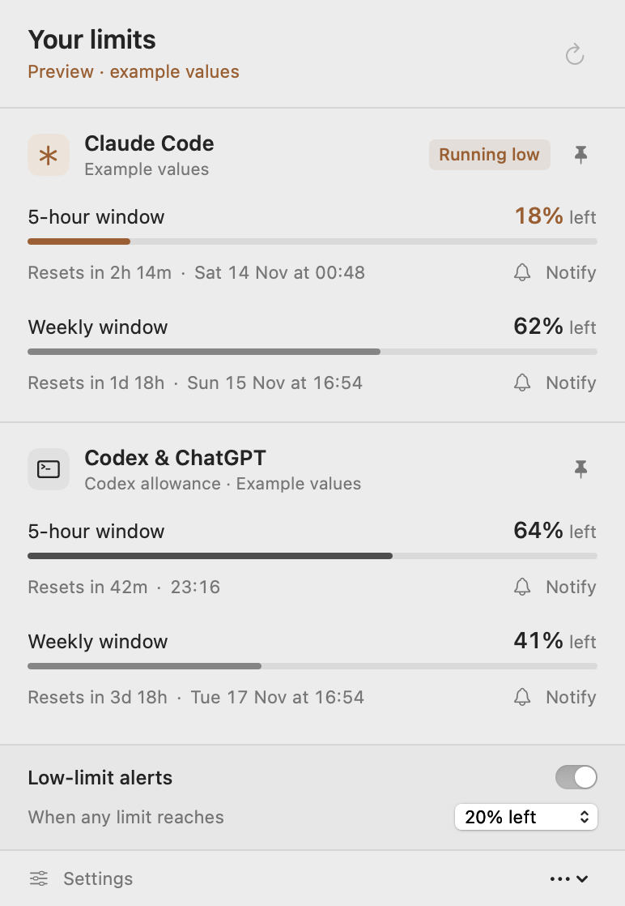
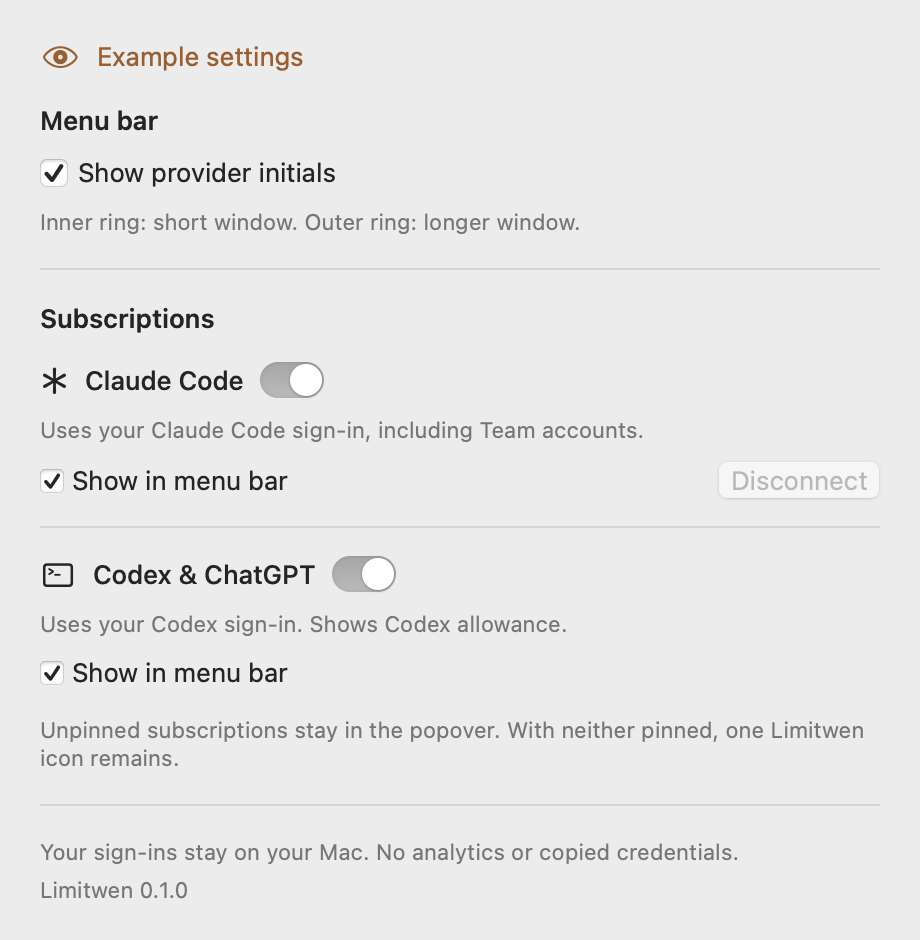

# Limitwen

**Claude Code and Codex usage limits, right in your Mac menu bar.**

Limitwen is a small native macOS app that shows your remaining AI subscription allowance, reset times and low-limit alerts. Glance at the rings, open the popover when you need detail, and get back to work.

[](https://github.com/uzair166/limitwen-app)
[](https://www.swift.org/)
[](LICENSE)
[](https://github.com/uzair166/limitwen-app/actions/workflows/ci.yml)

<p>
  
  
</p>

*Screenshots use labeled example data, not a real account.*

## What you get

- **Separate Claude Code and Codex rings.** Pin either, both or neither; one app icon remains when nothing is pinned.
- **Short and weekly windows when reported.** Inner ring = shorter window, outer ring = longer window. Weekly-only accounts get one ring.
- **Clear reset times.** Relative countdowns and exact local times, with optional per-window reset reminders.
- **Low-limit alerts.** Choose a remaining-allowance threshold; repeated polls do not send duplicate alerts for the same reset cycle.
- **Honest stale and missing data.** Unknown is not zero. A reset deadline does not invent a refill. Transient failures retain the last-known observation where account ownership remains valid.
- **A native Mac experience.** SwiftUI and AppKit, light/dark appearance, keyboard controls, one Settings panel and no Dock icon.

## Install

Limitwen currently builds locally from source. You need **macOS 14+ and Apple developer tools with Swift 6**. Check `xcrun swift --version` before installing. No separate subscription sign-in is added by Limitwen.

### Homebrew

```sh
brew tap uzair166/tap
brew install limitwen
limitwen
```

Or install directly with `brew install uzair166/tap/limitwen`.

The formula compiles the app on your Mac and installs a `limitwen` launcher. This avoids shipping an unsigned prebuilt download; it is not a notarized binary release. It does not change Gatekeeper or quarantine settings.

### Build it yourself

```sh
git clone https://github.com/uzair166/limitwen-app.git
cd limitwen-app
./scripts/build.sh release
open build/Limitwen.app
```

Quit a running checkout-built copy before rebuilding it. Scripts use your selected developer toolchain (`xcode-select`) or an explicit `DEVELOPER_DIR`.

An npm source installer is included in the repository. Registry publication is not available yet; use Homebrew or a source build in the meantime. See [release instructions](docs/RELEASING.md) for its packaging and publishing workflow.

## Connect your subscriptions

| Entry | What it reads | What you need |
| --- | --- | --- |
| **Claude Code** | Reported short, weekly and model-specific limits from Claude's native usage command and account-matched cache | Installed, signed-in Claude Code. Automatic refresh currently requires a supported Claude 2.x version starting at 2.1.273. Enable **Connect** in Settings. |
| **Codex & ChatGPT** | **Codex allowance** through the installed Codex CLI's app-server interface | Installed, signed-in Codex CLI. Use `codex login` if needed, then refresh. |

The combined Codex & ChatGPT entry does **not** claim to measure separate ChatGPT message limits. Account plans differ: Limitwen only displays the windows the source actually reports. Claude Team accounts can expose local usage too; availability depends on the installed CLI and source data, not just the plan name.

Provider interfaces can change. Claude's usage cache is an observed implementation detail, not a guaranteed public API. See [provider contracts](docs/ARCHITECTURE.md) for compatibility boundaries and failure behavior.

## Privacy

Limitwen does not collect analytics, copy authentication tokens, scrape browser cookies or send model prompts to check your limits. Your installed CLIs use their own sign-in to retrieve usage. That means quota refreshes can make network requests through those CLIs; “local integration” does not mean “never connects to the internet.”

Preferences and notification deduplication stay on your Mac. Codex snapshots stay in memory rather than an account-unbound disk cache. Claude cache identity is checked and then discarded. Notification permission is requested only when you turn on a reminder or alert.

## Everyday use

Click a ring to open usage. Right-click for refresh, Settings and Quit. Press **⌘,** for Settings and **Escape** to close the popover. Settings lets you show provider initials, enable subscriptions and choose which ones appear in the menu bar.

Meters always show **remaining** allowance. A dim or unknown reading is not a fresh entitlement. At a reset time, Limitwen checks again rather than assuming the quota replenished.

## Development

```sh
./scripts/test.sh           # deterministic, offline Swift tests
./scripts/check.sh          # tests, build, helper and bundle checks
./scripts/test-ui.sh        # native presentation; unlocked Mac required
npm test                   # installer/launcher tests; Node 20+ required
```

There are no third-party Swift dependencies. Default tests do not require a paid account or live network. Graphical, live-account and assistive-technology checks remain separate from headless CI.

Read [Contributing](CONTRIBUTING.md), [Design](docs/DESIGN.md) and [Architecture](docs/ARCHITECTURE.md). Report bugs through [GitHub Issues](https://github.com/uzair166/limitwen-app/issues) and security concerns through [private reporting](https://github.com/uzair166/limitwen-app/security/advisories/new).

## License

[Zero-Clause BSD (0BSD)](LICENSE). Use it, modify it, redistribute it or use it commercially. **No attribution required.**

Limitwen is an independent project, not affiliated with or endorsed by Anthropic or OpenAI. Provider names identify the services it works with.
